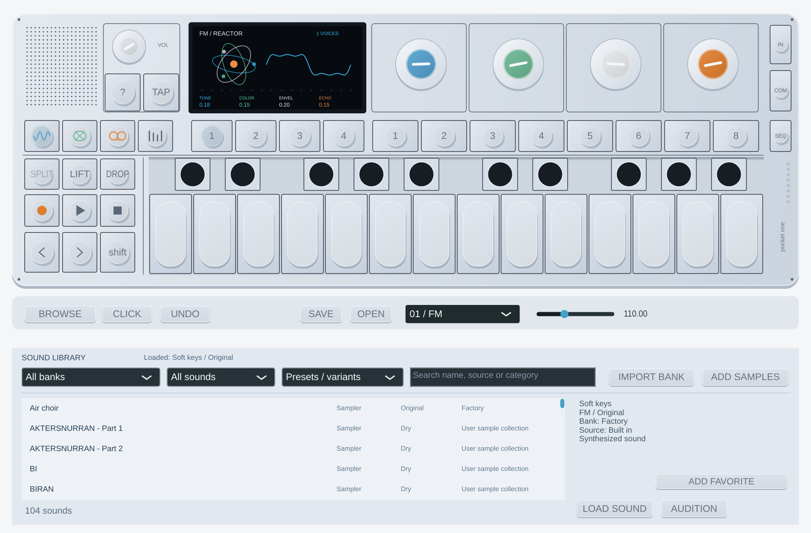
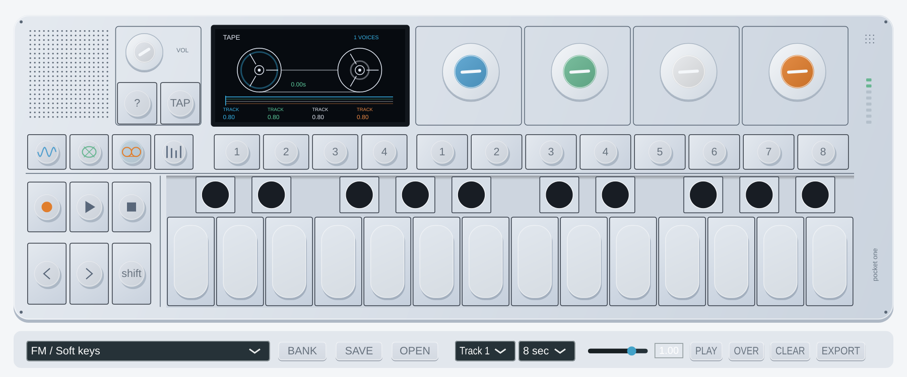

# Pocket One 0.13.0

An OP-1-inspired **VST3 instrument and standalone application**, written in C++17 with JUCE 8. Independent of Teenage Engineering; no original firmware, factory samples, graphics or branding are included. The interface uses a grey enclosure, dark animated display, blue/green/white/orange encoders and two rows of button keys.



Version 0.13.0 adds **[Value 246 Voice](docs/value-voice246-native.md)**: independent per-voice modulation of Phase/Digital controls or common ADSR. Five additional studies reuse the set-4 MIDI knobs; old FX parameters, mappings and projects are preserved. Other engines/routes and hardware matching remain pending; [full coverage](docs/original-op1-coverage.md).

**Active work: firmware DSP reconstruction.** The [component workplan](docs/firmware-dsp-workplan.md) prioritizes engines, filters, envelopes and modulators. [Cluster](docs/cluster246-kernel.md) has a validated isolated coefficient-parameterized kernel; original L1 normalization and full integration remain pending. Presets, sound banks and video matching are deferred.

**Cluster progress:** [Core note-on/release routing and six interleaved slots](docs/cluster246-core-routing.md) checked against another 131,072 samples with shared RNG. The [five observed normalization entries](docs/cluster246-normalization.md) and [shared initialization with REA support](docs/cluster246-shared-init.md) remain available. Three normalization entries and full integration remain unresolved.

As a dependency of that route, [common ADSR transitions](docs/cluster246-envelope-transitions.md) add 327,680 checked samples: initialization and a fade before the new attack. Full Cluster envelope routing remains pending; this does not change the installed plugin.

[VoiceCtl note preparation](docs/cluster246-note-activation.md) checks 128 pitch words, velocity and activation with an explicit tuning coefficient. The ADSR handoff remains pending in partially encrypted L1.

Version 0.8.0 added optional **[Phase 246 CORE](docs/phase246-native.md)**: a playable independent Pd reconstruction at a fixed 88.2 kHz internal clock with 16 additional raw-control patches. Its core is tested against original instructions in the GNU simulator; NCO, envelope, modulation and output filtering are ours. Existing Phase presets remain available.

Version 0.7.0 added four stable **Screen: Knob 1 Blue / 2 Green / 3 White / 4 Orange** host parameters. Map them once and the assignments follow the current display across sets 1–4. Old mappings to individual sound parameters keep their original destination. **PURGE BANK** permanently deletes the selected imported bank (or all imported banks with All banks selected), unloads its active audio, and clears its library references after confirmation. Factory sounds, source ZIPs and already saved projects are preserved. Close other instances first. Reimporting an identical manifest replaces validated copies and repairs missing audio without accumulating directories.

## Instruments and controls

[Additional Phase 246 core study bank](docs/phase-core-studies.md): 16 sample
presets sharing 13 unique WAVs, compatible with 0.7.0. Raw stored controls are
applied to the independently reconstructed Pd core. Original control routing,
ADSR/FX/LFO/octave behavior and full voice equivalence remain unverified. The
current factory/user banks and published installers are preserved.

Eight-voice velocity-sensitive **FM**, **phase distortion**, **plucked string**, **sampler**, **drum** and **24-pad sample kit** engines. Select the engine above the display, use the factory-sound menu, or play MIDI and the on-screen keyboard. The arrow buttons transpose the keyboard in sound modes. Computer keyboard notes start on A when the keyboard component has focus. MIDI channels remain independent for note release/sustain, with a fixed +/-2 semitone pitch wheel range on FM, phase and sampler. The string engine's delay-line fundamental is not currently pitch-bent; its tonal overlay can be modulated.

SYNTH/DRUM/TAPE/MIX select modes. T1 selects the engine page, T2 the envelope, T3 effects and T4 LFO. In tape/mixer mode T1–T4 select a track. SEQ reveals the 16-step editor. Shift + a sound slot 1–8 stores the edited sound; synth/drum assignments and favorites persist in project state. The four encoders change function with the selected page:

| Page | Blue | Green | White | Orange |
| --- | --- | --- | --- | --- |
| SYNTH | Tone / sample start | Color / sample length | Envelope macro | Echo mix |
| ENV | Attack | Decay | Sustain | Release |
| LFO | Rate (0.05–20 Hz) | Depth | Pitch / filter | Sine / triangle / square |
| FX | Delay time (50–1000 ms) | Feedback | Echo mix | Drive |
| TAPE | Track 1 gain | Track 2 gain | Track 3 gain | Track 4 gain |

Double-click an encoder to restore its parameter default. Parameters are automatable in a DAW. The five original macros, delay time/feedback and drive use 12 ms smoothing; engine switches and track gains are immediate. The envelope macro scales attack/release in addition to the ENV page's independent ADSR controls. OUTPUT is the master level, affecting live sound and tape playback, and is smoothed over 5 ms.

**Sampler:** choose SAMPLER, then LOAD a WAV/AIFF. Up to the first 16 seconds at 8–192 kHz are imported and stereo files are downmixed to mono. C4/MIDI 60 is the root. START and LENGTH trim the window; LOOP repeats it while the note is held. IN monitors enabled host/standalone audio input; Shift + IN captures up to 16 seconds into the sampler. Configure/unmute the input device first. Empty sampler slots display a load prompt.

**Drums:** C/G pitch classes trigger kick, D/E snare, and other pitch classes hi-hat. Tone, Color and the Envelope macro change pitch/noise/decay. Hits are one-shots. The separate KIT engine includes Studio, Circuit and Dust: three 24-pad kits using the existing original samples, mapped to MIDI 60–83 and common GM aliases.

**Sequencer:** PLAY enables 16th-note playback; in a DAW, also start host transport. Latch Shift to reveal the steps, then click them to toggle gates. Play a note, then **Shift-click** a step to write that pitch. Hover a step to read its note. Host PPQ/tempo drive pattern position, including seeks; otherwise the internal tempo runs the pattern. MIDI sustain (CC64) is supported. STOP disables sequence/tape recording/playback and requests a voice/effect panic.

## Four-track tape and sessions



Choose TAPE, select a track and a 4/8/16-second loop. Arm REC, press the tape PLAY button, then play the instrument or sequence. OVER adds to existing material; with OVER off, recording replaces the selected track as the playhead passes. Other tracks keep playing. Turn REC off to listen. In a DAW, host transport must also run.

Playback speed ranges from -2x to +2x, including reverse and freeze. Recording always advances at normal 1x. The left arrow rewinds in tape mode; the right arrow toggles x1/x2 playback; CLEAR immediately erases the selected track. Track audio is recorded before the master OUTPUT gain. Four mono tracks are summed to stereo dual mono. EXPORT writes the selected loop duration as a **four-channel, 24-bit WAV of the raw tracks**; speed/mixer/master settings are not baked into the export.

**SAVE / OPEN** manage complete `.pocketone` sessions. DAW project state also embeds the sample, pattern and all four tape tracks, using 24-bit WAV compressed for storage. Original sample paths are not required. Restoring disarms tape recording. Save/load operations copy and encode audio and can briefly block processing; do them while transport is stopped. Standalone automatic persistence has not been established, so explicitly save before quitting.

This is a constrained loop recorder, not a full recreation of OP-1 tape. It now supports split/join, lift/drop, slide and one-edit undo. It still has no long disk-streamed tape, radio, hardware data takes or stereo panning. It is not compatible with original OP-1 presets/projects. There has been no measured hardware matching. High harmonic settings can alias; production-grade oversampling remains outstanding.

## Windows installer

See [Windows build/install instructions](docs/windows.md). Run `packaging\windows\build.cmd` on Windows with Visual Studio 2022 C++ tools, CMake, Git and NSIS 3.11+ installed. The installer is generated in `dist/`, installs the VST3 bundle to the standard Common Files folder, installs the standalone app/Start menu shortcut, and registers an uninstaller. The C++ runtime is statically linked.

**Windows x64 installer:** `Pocket-One-0.13.0-Windows-x64-Setup.exe`. Seventeen Windows suites and installer/uninstaller checks pass under Wine, including actual VST3 loading and Common Controls manifest inspection. Fifteen Linux suites pass. Native CI for the 0.4.0 SQLite fix also passed Windows/Linux/macOS, including Windows app startup and installer checks; this does not validate a native Ableton project. The installer remains unsigned. See [cross-build instructions](docs/windows-cross-build.md).

## Build from source

CMake 3.22+, a C++17 compiler and Git are required. JUCE is pinned to `51a8a6d7aeae7326956d747737ccf1575e61e209` (8.0.6); use `-DJUCE_PATH=/path/to/JUCE` for an existing checkout. Native Windows builds require MSVC, not MinGW.

Debian/Ubuntu prerequisites:

```sh
sudo apt-get install build-essential cmake pkg-config libasound2-dev \
  libx11-dev libxext-dev libxinerama-dev libxrandr-dev libxcursor-dev \
  libxrender-dev libxfixes-dev libfreetype-dev libfontconfig-dev libgl-dev
```

From the repository root (Windows: use `cmake -S . -B build -A x64` instead of the first command):

```sh
cmake -S . -B build -DCMAKE_BUILD_TYPE=Release
cmake --build build --config Release --parallel 2
ctest --test-dir build -C Release --output-on-failure
```

Outputs: `build/PocketOne_artefacts/Release/VST3/Pocket One.vst3` and `Standalone/`. Copy the **entire VST3 bundle** to your plugin directory, rescan, and insert it on an instrument track. Binaries are specific to their build operating system; Linux binaries cannot run in Windows DAWs. For this prepared cloud machine, source `scripts/cloud-env.sh` before building; see [cloud setup](docs/cloud.md).

## Verification and licensing

Thirteen Linux CTest targets (fifteen on Windows) exercise the core engines, tape and plugin, including real audio, MIDI offsets, host seeks, embedded sample/tape state and four-channel export. For dependency-free core tests, configure with `-DPOCKET_BUILD_PLUGIN=OFF`. `engine_tests build/demo.wav` renders an audio demonstration. The smoke executable optionally captures both editor pages under a real/virtual display:

```sh
xvfb-run -a ./build/plugin_smoke_artefacts/Release/plugin_smoke "$PWD/docs/interface.png"
```

See [validation evidence and limitations](docs/validation.md) and [OTTO/TOP-1 design references](docs/references.md). No code or assets from those projects have been imported.

Pocket One's original source is distributed under **AGPL-3.0-only**; see [LICENSE](LICENSE). This open-source distribution uses JUCE's AGPLv3 option and the bundled VST3 SDK's GPLv3 option. Third-party components retain their original terms. See [credits](CREDITS.md) and [third-party notices](THIRD_PARTY_NOTICES.md). Complete corresponding source, including pinned JUCE, is available in `downloads/v0.13.0`.

## Factory sounds

25 original presets, three embedded 24-pad drum kits and four melodic samples. See [the sound bank guide](docs/sound-bank.md) for MIDI mapping, sample credits and OP-1 preset references.

## User banks, animations and realtime audio

**BROWSE > IMPORT BANK** imports a local ZIP bank into a searchable library. Filter bank/type, preset variants, unique samples and favorites. ADD SAMPLES registers multiple WAV/AIFF files. The Loaded label remains separate from the browsing selection. Root notes are supported per sample and selected audio is embedded in DAW state. [User bank guide](docs/user-banks.md). The user-supplied 79-preset collection has a [direct download](downloads/user-banks/README.md); it is not relicensed as the original CC0 factory samples.

The [hardware-style editor and OLED animations](docs/hardware-interface.md) use original JUCE geometry inspired by the supplied OP-1 reference and OTTO-1. [Animated preview](docs/screen-animation.gif).

The processor reports **0 added latency samples**. The realtime test checks tracked heap activity and reports timing across 36 workloads. [Measurements and practical limits](docs/realtime-audio.md). A successful synthetic benchmark does not guarantee dropout-free operation on a particular driver/DAW; load/save/import audio with transport stopped.

See the [complete button/browser guide](docs/buttons-and-browser.md): contextual tape tricks, master EQ/FX pages, input capture, shortcuts and differences from the original firmware.

## Extended sequencing (introduced in 0.4.0)

Use **SEQ SETTINGS / SEQ: …** or **Shift + SEQ** for forward/reverse/pendulum/random patterns, held-note arpeggios, rate, gate, swing, length, velocity and a Euclidean rhythm mask. These independent implementations follow host position/tempo and save with the session. See [sequencer controls](docs/sequencers.md) and the [firmware research ledger](docs/firmware-analysis.md). No original firmware/resources are included.

## 24-pad kits

The **KIT EDIT** panel selects/auditions 24 pads across C4–B5 and edits trim, gain, pitch, reverse and one-shot/gated playback. Load WAV/AIFF per pad; active kits are embedded in projects. Legacy eight-slot banks keep their original note mapping. Factory kits combine the existing Studio/Circuit/Dust resources in three groups of eight; no original OP-1 resources are bundled. [Kit guide](docs/kits.md).
