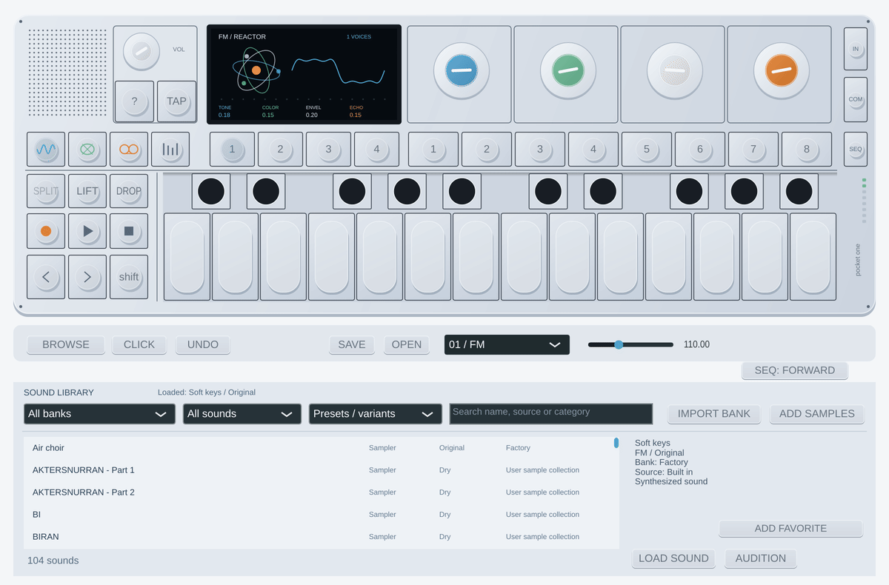

# Pocket One 0.11.0

**Sintetizador VST3 y aplicación independiente inspirados en el Teenage Engineering OP-1.** Interfaz gris, pantalla animada, cuatro mandos azul/verde/blanco/naranja y teclado de dos octavas. Implementación independiente; no contiene firmware, muestras de fábrica ni gráficos originales.

[English manual](README.en.md) · [Créditos](CREDITS.md) · [Licencia](LICENSE) · [Notas de versión](docs/releases/v0.11.0.md)



[Navegador de presets y muestras](docs/sound-browser.png) · [Guía de botones](docs/buttons-and-browser.md) · [Captura estática](docs/interface.png) · [Distribución y animaciones inspiradas en OTTO](docs/hardware-interface.md)

**Nuevo en 0.11.0:** [Punch 246](docs/punch246-native.md), efecto reconstruido con tres variantes adicionales y set 3 MIDI contextual. Teclado ampliado a −4…+4 octavas. [Cobertura del OP-1 completo](docs/original-op1-coverage.md): motores, FX, envolventes, modulación y ejercicios del manual, con inventario de 169 presets synth y 24 kits. El inventario no significa que todos estén implementados.

**Banco adicional:** [16 estudios del núcleo Phase / 13 WAV únicos](docs/phase-core-studies.md), compatibles con 0.7.0. Controles extraídos del firmware y renders contrastados con el núcleo original simulado; siguen siendo estudios experimentales sin el resto del preset original.

## Descargar

| Paquete | Descarga |
| --- | --- |
| Instalador Windows 10/11 x64 | [Pocket-One-0.11.0-Windows-x64-Setup.exe](https://github.com/jguillenconesa-coder/Tiny-one/raw/refs/heads/main/downloads/v0.11.0/Pocket-One-0.11.0-Windows-x64-Setup.exe) |
| Windows portable: aplicación y VST3 | [ZIP](downloads/v0.11.0/Pocket-One-0.11.0-Windows-x64-portable.zip) |
| Linux x86_64: aplicación y VST3 | [TAR.GZ](downloads/v0.11.0/Pocket-One-0.11.0-linux-x86_64.tar.gz) |
| Fuentes completas con JUCE | [Código fuente correspondiente](downloads/v0.11.0/Pocket-One-0.11.0-corresponding-source.tar.gz) |
| Kit de compilación del proyecto | [ZIP](downloads/v0.11.0/Pocket-One-0.11.0-Windows-build-kit.zip) |
| WAVs originales del banco de fábrica (CC0) | [ZIP de 28 muestras](downloads/v0.11.0/Pocket-One-0.11.0-Factory-Samples.zip) |
| Integridad de las descargas | [SHA256SUMS.txt](downloads/v0.11.0/SHA256SUMS.txt) |

También se ha configurado la creación de una [release de GitHub](https://github.com/jguillenconesa-coder/Tiny-one/releases) al publicar la etiqueta `v0.11.0`. Los archivos versionados de `downloads/v0.11.0` permiten descargarlos directamente desde el repositorio.

**Versión preliminar.** El instalador no tiene firma digital. Trece suites Linux y quince suites Windows bajo Wine, más instalación/desinstalación y carga del VST3 instalado. La validación nativa en Ableton/ASIO Windows real sigue pendiente. La release no incluye un instalador de macOS; CI genera sus artefactos de compilación.

## Instalar en Windows

1. Cierra el DAW y ejecuta el instalador. Requiere Windows 10/11 de 64 bits y permisos de administrador.
2. Elige VST3, aplicación independiente o ambos. El VST3 se instala en `C:\Program Files\Common Files\VST3\Pocket One.vst3`.
3. Abre tu DAW, vuelve a buscar plugins e inserta Pocket One en una pista de instrumento/MIDI. La aplicación independiente aparece en Inicio. Los bancos importados de 0.2.2 siguen siendo compatibles.
4. Para desinstalar, usa Configuración de Windows → Aplicaciones → Pocket One.

La versión portable se extrae sin instalador; copia el paquete `.vst3` completo a una carpeta que tu DAW explore. Un binario Linux no funciona en un DAW de Windows. [Instrucciones detalladas](docs/windows.md).

## Qué incluye

- **Seis modos y ocho voces:** FM, distorsión de fase, cuerda pulsada, sampler WAV/AIFF, batería sintética y kits de 24 muestras con edición por pad.
- **Controles hardware:** modos SYNTH/DRUM/TAPE/MIX; T1 motor, T2 ADSR, T3 FX y T4 LFO; accesos independientes SYNTH/DRUM; cinta con SPLIT/JOIN, LIFT/DROP, loop y tape tricks. MIX añade EQ y efectos de master.
- **MIDI y automatización:** velocidad, sustain CC64, pitch bend en motores compatibles y sonidos iniciales.
- **Secuenciadores:** patrón de 1–16 pasos con dirección normal, inversa, péndulo o aleatoria; arpegiador UP/DOWN/UP-DOWN con 1–3 octavas, gate, swing y máscara euclídea. Sincronización con tempo, posición y saltos del host. [Uso](docs/sequencers.md).
- **Cinta:** cuatro pistas mono, bucles de 4/8/16 segundos, grabación, overdub, mezcla, velocidad/reversa y exportación WAV de cuatro canales.
- **Sesiones:** muestras y cinta incorporadas al estado del DAW y a archivos `.pocketone`.


[Análisis estático del firmware 246 con REA](docs/firmware-analysis.md): inventario verificable de 169 presets synth y 24 drum. El firmware y sus recursos no se incluyen en el plugin.

[Editor de kits de 24 pads](docs/kits.md): recorte, volumen, afinación, reversa y gate por pad.

## Uso rápido

Abre **BROWSE**: filtra por banco/tipo, busca por nombre y distingue presets/variantes de muestras únicas. **LOAD SOUND** o doble clic carga; **AUDITION** permite preescuchar. Elige favoritos y asigna sonidos editados a 1–8 con Shift. Selecciona un motor y toca el teclado o envía MIDI. Las flechas cambian de octava en modos de sonido. Arrastra los mandos; el doble clic recupera el valor por defecto. T1–T4 cambian la función de los encoders. Shift + un botón 1–8 asigna el sonido seleccionado a ese acceso rápido.

**Sampler:** elige SAMPLER → LOAD. Importa los primeros 16 segundos del WAV/AIFF; C4/MIDI 60 es la nota raíz. START y LENGTH recortan la ventana; LOOP repite mientras mantienes la nota. Las entradas estéreo se convierten a mono.

**Secuenciador:** PLAY lo activa; en un DAW también debes iniciar el transporte. Activa Shift para mostrar los pasos y pulsa para activarlos/desactivarlos. Toca una nota y haz **Shift-clic** en un paso para escribirla. STOP detiene secuencia/cinta y libera el sonido.

**Cinta:** elige pista y duración en TAPE, arma REC, pulsa PLAY y toca. OVER suma material; desactivado, reemplaza lo que pase bajo el cabezal. La grabación funciona a velocidad normal; la reproducción permite reversa y congelación. CLEAR borra la pista seleccionada sin undo. EXPORT escribe un WAV de cuatro canales con las pistas sin aplicar mezcla/velocidad/master.

**SAVE / OPEN** guardan y recuperan sesiones completas. Guarda antes de cerrar la aplicación independiente. Haz las operaciones de sesión con el transporte detenido: copiar y codificar audio puede interrumpir brevemente el procesamiento.

[Manual completo en inglés](README.en.md) · [Cambios de la versión](docs/change-log.md)

## Compilar y probar

C++17, CMake 3.22+, Git y JUCE 8.0.6, fijado a `51a8a6d7aeae7326956d747737ccf1575e61e209`. CMake descarga JUCE; puedes usar `-DJUCE_PATH=/ruta/a/JUCE`. Windows requiere Visual Studio 2022 con herramientas C++ y NSIS 3.11+ para generar el instalador; JUCE 8 no admite MinGW.

```sh
cmake -S . -B build -DCMAKE_BUILD_TYPE=Release
cmake --build build --config Release --parallel 2
ctest --test-dir build -C Release --output-on-failure
```

En Windows configura con `cmake -S . -B build -A x64`. `packaging\windows\build.cmd` compila, prueba y genera el instalador. El archivo de fuentes completas permite compilar seleccionando el JUCE incluido sin descargarlo de nuevo.

- [Dependencias y comandos por plataforma](README.en.md#build-from-source)
- [Compilación cruzada y validación Windows](docs/windows-cross-build.md)
- [Entorno en la nube](docs/cloud.md)
- [Pruebas realizadas y límites de la validación](docs/validation.md)
- [Cómo contribuir](CONTRIBUTING.md)

## Alcance, créditos y licencia

Pocket One se aproxima a la distribución de controles y al flujo creativo del OP-1; **no es una emulación completa ni se ha demostrado equivalencia sonora**. Faltan cinta larga de seis minutos, todos los secuenciadores originales, radio, data takes y más motores y mejoras de antialiasing. No importa proyectos/presets originales. El fundamental del motor de cuerda no responde todavía a pitch bend.

[Créditos completos](CREDITS.md): Teenage Engineering como inspiración; OTTO/TOP-1 como referencias; JUCE, Steinberg y los proyectos de herramientas/bibliotecas utilizados. No hay afiliación ni recursos originales copiados.

Código original: **AGPL-3.0-only**, con [licencia completa](LICENSE). La distribución abierta usa la opción AGPLv3 de JUCE y GPLv3 del SDK VST3. Los componentes externos conservan sus licencias y avisos: [THIRD_PARTY_NOTICES.md](THIRD_PARTY_NOTICES.md).

## Presets y bancos de muestras

25 presets originales, tres kits integrados de 24 pads y cuatro instrumentos muestreados. [Guía del banco y referencias de presets OP-1](docs/sound-bank.md).

**BROWSE → IMPORT BANK** importa un ZIP y lo identifica por su banco. **ADD SAMPLES** añade archivos a la biblioteca. La colección de 79 presets y dos kits aportada por el usuario tiene [descarga directa](downloads/user-banks/README.md). El navegador ofrece variantes y vista de muestras únicas sin duplicarlas. Favoritos y slots se guardan con el proyecto. [Uso, formato y generador de bancos](docs/user-banks.md).

## Audio y latencia

El plugin declara 0 muestras de latencia añadida. Las pruebas incluyen ocho voces, cinta/FX y buffers de 64/128/256 a 48/96 kHz, además de comprobación de heap en el callback. Consulta [medidas, configuración y límites](docs/realtime-audio.md): la prueba sintética no certifica ausencia de dropouts en Ableton. Usa ASIO en Live y comienza con 128 muestras a 48 kHz. Carga/guarda audio con el transporte parado.

[Correspondencia completa de botones, combinaciones Shift y límites](docs/buttons-and-browser.md).

[Controles MIDI y automatización con nombres claros](docs/midi-controls.md) · [Avance del estudio DSP original](docs/dsp-research.md).

## Referencias originales en el repositorio privado

La 0.6.0 añadió CLEAN SAMPLE para conservar el espectro de los samples y un [banco privado de referencia](downloads/private-banks/README.md) con nueve sampler y 14 kits de 24 pads del firmware suministrado. Se importan desde BROWSE → IMPORT BANK. Son fuentes secas con regiones/frecuencias raíz recuperadas; no son una conversión de los motores FM/Phase ni de sus efectos. Las descargas requieren acceso a Tiny-one.
