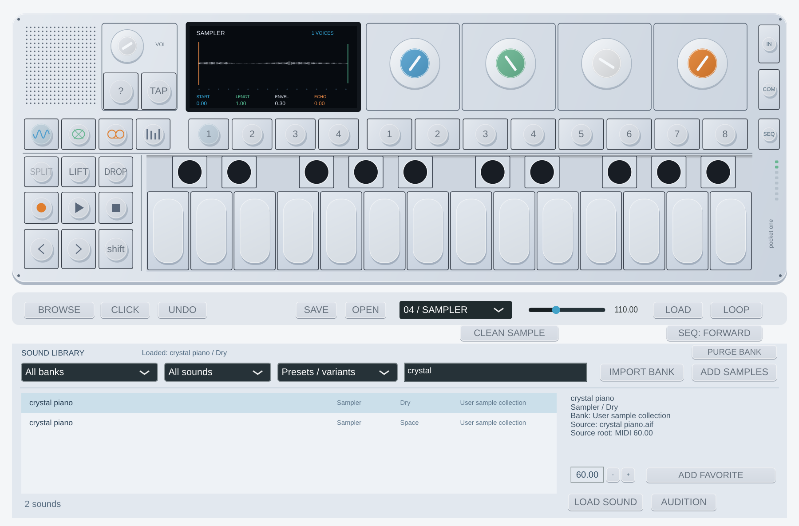

# Navegador y botones — Pocket One 0.5.0

## Seleccionar sonidos sin confundir muestras y presets

Pulsa **BROWSE** para mostrar/ocultar la biblioteca. También puedes usar Shift + SYNTH/DRUM para abrirla filtrada.

1. **Banco**: Factory, el nombre del banco importado, My samples o All banks.
2. **Tipo**: sintetizadores, samples o baterías/kits.
3. **Vista**: presets con sus variantes, muestras únicas o favoritos.
4. **Buscar**: nombre, categoría, variante o nombre del archivo de origen.
5. Selecciona una fila: el panel derecho muestra origen, banco, variante y raíz MIDI. **LOAD SOUND** o doble clic carga; **AUDITION** carga y toca brevemente una nota. La selección de una fila por sí sola no cambia el sonido activo.

La cabecera **Loaded** identifica el sonido cargado aunque estés explorando otra fila. Dry y Space son variantes del mismo audio; la vista Unique samples las reúne, pero conserva como muestras separadas las partes de grabaciones largas. La raíz original se muestra en los detalles y el control numérico modifica la raíz del sample actualmente cargado.

**IMPORT BANK** añade el ZIP sin descomprimirlo. Reimportar un ZIP idéntico no duplica la instalación; las entradas tienen identificadores estables. **ADD SAMPLES** importa varios WAV/AIFF a una biblioteca persistente. Se usan los primeros 16 segundos por archivo, máximo 16 MB por archivo. Para dividir grabaciones completas utiliza el generador de bancos documentado en [user-banks.md](user-banks.md).

Los favoritos y las asignaciones de sonido se guardan en el proyecto/sesión; no se garantiza su guardado automático al cerrar el standalone sin SAVE. Los archivos de bancos permanecen en la biblioteca local.

## Correspondencia de botones

La referencia es el manual OP-1 v2.2 aportado: apartados 2, 5, 6, 8.4–8.12 y 9. No se redistribuye el PDF. Las acciones se adaptan al instrumento VST3; no se afirma identidad de firmware.

| Botón | Función implementada |
| --- | --- |
| SYNTH / DRUM | Cambian a la categoría y recuperan su último preset cargado. Shift abre el navegador filtrado. Guarda los ajustes editados en un slot antes de cambiar a otra categoría si quieres recuperarlos. |
| T1–T4 en sonido | Motor, ADSR, efectos y LFO, respectivamente. |
| TAPE | Cinta de cuatro pistas. T1–T4 seleccionan pista. Azul: posición; verde: nivel de esa pista; blanco: velocidad; naranja: ganancia de grabación. |
| MIX | T1 niveles de cuatro pistas; T2 EQ propia de tres bandas y mezcla; T3 drive/delay de master; T4 master, entrada, grabación y click. |
| 1–8 en SYNTH / DRUM | Dos bancos independientes de ocho accesos. Shift + número guarda los parámetros editados del sonido catalogado; número recupera. Se guardan con el proyecto. Para muestras sueltas, usa ADD SAMPLES y carga su entrada de biblioteca antes de asignarla. |
| REC | Arma y comienza a grabar cinta. Shift + REC solo arma; PLAY comienza después. La entrada externa se añade si IN está activado. |
| PLAY / STOP | En sonido, controla el patrón; en TAPE/MIX, controla la cinta. STOP detiene ambos, desarma y libera notas; termina una captura de entrada activa. Shift + PLAY reproduce cinta en reversa; Shift + STOP rebobina. |
| Flechas | Octavas en sonido. En cinta: mantener pulsa rebobinado/avance x5, soltar recupera el estado previo. Shift salta un compás de cuatro tiempos al tempo efectivo del host/interno. |
| SPLIT / Shift + SPLIT | Divide la toma en el cabezal / une las divisiones vecinas. |
| LIFT / Shift + LIFT en cinta | Levanta la toma o región de loop; Shift levanta las cuatro pistas. El audio permanece en un portapapeles temporal. |
| DROP en cinta | Pega el audio levantado en el cabezal, avanza al final y permite repetir pegados. |
| LIFT / DROP en sonido | Copia/restaura parámetros y muestras del sonido sin sustituir la cinta, patrón o mezcla actuales. No equivale a los data takes del firmware. |
| DROP de cinta a sonido | Carga el audio levantado como muestra de sampler. Al levantar cuatro pistas se mezclan a mono. |
| Azul en cinta + Shift | Desliza la toma mientras la cinta está parada; impide salir del rango o pisar otra toma. |
| SEQ | Muestra/oculta el editor de patrón de 16 pasos. Click conmuta paso; Shift + paso escribe la última nota MIDI. |
| TAP / Shift + TAP | Tap tempo / conmuta metronomo. El host tiene prioridad al proporcionar tempo. CLICK ofrece el mismo interruptor. |
| IN / Shift + IN | Monitoriza entrada / inicia o termina captura de hasta 16 segundos al sampler. Requiere entrada de audio habilitada y enrutada. |
| COM | Exporta mezcla de cinta a WAV de dos canales con EQ/FX/master, cuatro pistas WAV sin mezcla, o guarda/abre sesión. |
| ? / Shift | Guía de controles / modificador de acciones secundarias y asignación de slots. |
| UNDO | Alterna deshacer/rehacer la última edición destructiva soportada de cinta; no deshace grabaciones en tiempo real. |

Para editar, levantar, pegar o deslizar audio, **para la cinta**. El portapapeles y el undo son temporales; los cortes, puntos de loop, memorias, slots, favoritos y audio de pistas se guardan con el proyecto. El audio activo sigue incorporado al estado, pero los slots que apuntan a bancos necesitan que sus bancos estén instalados.

## Botones 1–8 como tape tricks

En **TAPE y MIX** cambian de función, tal como describe el apartado 8.12:

| Número | Acción | Shift |
| --- | --- | --- |
| 1 IN | Marca inicio de loop | Salta al inicio |
| 2 OUT | Marca final de loop | Salta al final |
| 3 LOOP | Activa/desactiva región de loop | Selecciona y repite la toma actual |
| 4 BREAK | Mantener interrumpe cinta; con loop, su posición continúa en segundo plano | Misma acción |
| 5 REV | Invierte dirección | Misma acción |
| 6 CHOP | Mantener repite un grano de semicorchea al tempo | Misma acción |
| 7 MEM1 | Recupera memoria de cinta/mezcla | Guarda memoria |
| 8 MEM2 | Recupera segunda memoria | Guarda memoria |

Las memorias guardan velocidad, niveles, loop, EQ, master FX y ganancias. Aquí se guardan con Shift + tecla; no se reproduce la combinación física de mantener una memoria mientras se gira un encoder.

## Entrada y límites reales

En standalone selecciona entrada en las opciones Audio/MIDI y desmarca **Mute audio input** si está activado por JUCE. En un DAW configura la entrada del plugin si el host la permite; algunos hosts no ofrecen entrada de audio para instrumentos, en cuyo caso usa standalone u otro enrutamiento compatible. La captura estéreo se mezcla a mono. Capturas y cargas directas se guardan con la sesión; para favoritos y slots de una muestra de archivo, regístrala con ADD SAMPLES.

La cinta sigue limitada a 4/8/16 segundos, grabación a x1 y cuatro pistas mono. No hay cinta de seis minutos, disco continuo, data takes de parámetros del OP-1, radio FM, accesorios físicos, USB de dispositivo ni todos los secuenciadores originales (Endless/Tombola/Finger/Sketch). COM hace un render offline de la cinta; no captura una interpretación en directo como el álbum físico. Los efectos/EQ son algoritmos propios y la mezcla exportada es dual mono. Estas limitaciones no se ocultan detrás de controles decorativos.

## Secuenciadores ampliados (0.4.0)

**SEQ SETTINGS / SEQ: …** o **Shift + SEQ** permite elegir dirección, arpegiador, longitud, velocidad, swing, gate y máscara euclídea. **SEQ** muestra/oculta pasos. PLAY en SYNTH/DRUM inicia el secuenciador; en ARP mantén notas MIDI o del teclado en pantalla. [Guía con los valores y límites](sequencers.md). Los modos nuevos son implementaciones propias; no ejecutan código del OP-1.

## Kits de 24 pads (0.5.0)

Carga un kit en DRUM y pulsa **KIT EDIT**. Los 24 botones seleccionan/preescuchan pads; la forma de onda muestra el recorte. Cada pad tiene START, END, GAIN, PITCH, REVERSE y GATED. LOAD PAD sustituye su audio; RESET PAD recupera sus controles. Los ocho accesos de sonido de la máquina siguen seleccionando presets, mientras que el teclado toca los pads. [Guía y compatibilidad](kits.md).

## Ajustes de 0.9.0

En Phase 246 CORE, **246 ENVELOPE** activa la reconstrucción de envolvente y el
set 2 sigue sus cuatro controles. Nuevos presets CORE la activan; sesiones/slots
0.8.0 conservan el modo anterior. **STOP/pánico** corta también el historial de
salida; no elimina la cinta. Los cambios normales de preset conservan las colas
master. FILTER LFO ya actúa en las rutas nativa y CLEAN cuando se selecciona.
[Guía Phase](phase246-native.md) · [Motores](audio-engines.md).

## Octavas y Punch (0.11.0)

En modo synth/drum, las flechas del teclado alcanzan −4…+4 octavas. El extremo
superior del teclado queda limitado a nota MIDI 127. La posición del teclado se
guarda en sesión, slots editados y LIFT/DROP; no transpone notas MIDI externas
ni equivale a aplicar aún el campo octave de todos los patches de fábrica.
El botón PUNCH 246 activa el nuevo efecto mono y los cuatro mandos del set 3.
STOP/CC120 cortan su cola; algunas configuraciones mantienen oscilación.
