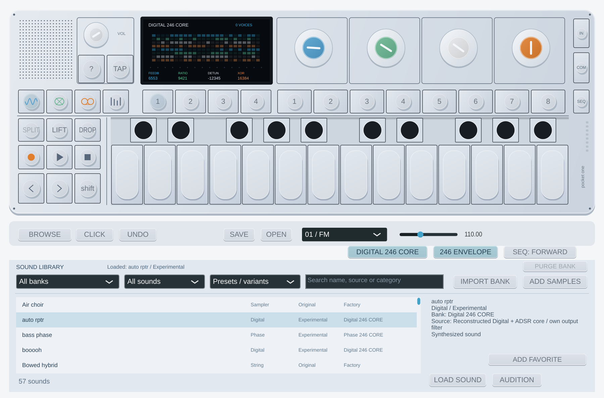

# Digital 246 CORE — Pocket One 0.10.0

El banco integrado **Digital 246 CORE** añade 16 sonidos experimentales. No hay
que descargar ni importar un ZIP: abre **BROWSE**, selecciona ese banco y carga
un preset. Se conservan Factory, Phase 246 CORE y los bancos importados.

La reconstrucción independiente del oscilador Digital coincide con **262.144
muestras y 2.048 estados completos** de funciones originales aisladas en el
simulador GNU documentado. Esto no equivale a una comparación acústica con el
aparato ni a reproducir todos los componentes de sus presets.

El selector de motor conserva su orden anterior. Digital se activa dentro de
**FM** mediante **DIGITAL 246 CORE**; al desactivarlo vuelve el FM propio.
Los presets del nuevo banco activan el oscilador y la envolvente reconstruida.

| Set 1 / color | Control | Rango raw |
| --- | --- | --- |
| Azul | Feedback del primer oscilador | 0…32767 |
| Verde | Ratio de la frecuencia secundaria | 2048…26624 |
| Blanco | Detune / sync | −32768…32767 |
| Naranja | Intensidad de la máscara XOR | 0…32767 |

Estos son valores internos, no Hz ni semitonos. El verde selecciona un tramo
de ratio y el blanco añade ajuste fino; el blanco positivo habilita la rama de
sincronización observada. Cruzar tramos puede producir cambios de timbre bruscos
por el propio algoritmo. Los controles se suavizan en nuestra integración.

**Set 2:** Attack / Decay / Sustain / Release de la envolvente rev246 cuando
**246 ENVELOPE** está activo. Release raw aumenta hacia tiempos más cortos.
Desactivarlo recupera la envolvente anterior. Sets de FX y LFO siguen usando
nuestros efectos. Las cuatro asignaciones **Screen: Knob 1 Blue … Knob 4 Orange**
siguen la página y el motor sin volver a asignar el controlador.
Para automatizar un destino fijo usa los nombres **Digital 246: …** del host.

Los parámetros Digital se añaden después de todos los existentes en 0.9.0.
No cambian los IDs del VST3, la lista normalizada de motores ni las cuatro
identidades de los knobs. Proyectos y slots antiguos cargan con Digital apagado;
los nuevos guardan los controles, envolvente y selección. También se incluyen
en LIFT/DROP y slots editados.

Los 16 nombres y campos numéricos proceden de `op1_factory.db` rev246. Solo se
aplican los cuatro controles del oscilador y los primeros cuatro ADSR. Se omiten
octave, FX, LFO y cuatro campos adicionales de envolvente originales. Por eso
no deben interpretarse como copias completas de los presets de la máquina.

La integración usa reloj interno de 88,2 kHz, seno verificado, adaptación causal
y filtrado propios. No espera a reunir un bloque del host ni declara latencia
adicional. El filtro tiene retardo de grupo. NCO, asignación de ocho voces,
reinicio por nota, mezcla, velocidad y dither por voz son decisiones propias.
La animación de feedback/XOR está dibujada para esta interfaz y no es una captura
de la pantalla del firmware.

[Método reproducible](digital246-research.md) · [Rendimiento](realtime-audio.md) ·
[Estado de los motores](audio-engines.md).
