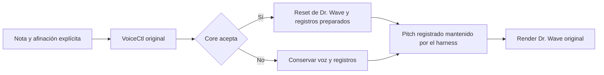

# Dr. Wave rev246: activación VoiceCtl y preparación de nota

Se contrasta **VoiceCtl `0x01a84414`** con los objetos de Dr. Wave y su render
completo: **128 palabras de tabla, 512 activaciones y 61.568 muestras adicionales**.
Las seis voces conservan estado entre eventos, incluyendo pitch, velocidad y
actividad anteriores cuando Core rechaza una nota.

**Afinación y pitch mantenido son entradas explícitas del ensayo.** No se ha
recuperado la calibración predeterminada, el proveedor original del buffer de
pitch, el asignador, el reloj ni el relevo ADSR/salida. El código sigue aislado
del plugin y no cambia el instalador.

## Contrato contrastado

| Parte | Comportamiento observado |
| --- | --- |
| Aceptación Core | Si el sonido cargado no coincide con el seleccionado, no hay reset de Dr. Wave ni escrituras de pitch, velocidad o actividad. |
| Reset de voz aceptada | El callback Dr. Wave borra sus cinco fases de lectura y acumulador de inversión. Conserva el resto del objeto; no reconstruye la onda por sí mismo. |
| Pitch explícito | La palabra signed32 en offset 12 del argumento se usa cuando es distinta de cero. En esa rama se ignora el índice de nota, incluso fuera de 0–127. Cero es el selector de tabla, no un pitch explícito nulo. |
| Lookup | Con pitch explícito cero se consulta la tabla de 128 palabras, desde `0x01dfe530`. El ensayo vuelve a ejecutar su bucle original de copia desde `0x018c21b0`. |
| Afinación | El índice observado en `0x018c2184` vale 1200. El ensayo escribe su coeficiente explícito en `0x027fc720 + 1200 × 4`, sin atribuirle un valor original predeterminado. |
| Pitch preparado | Producto Q31 y desplazamiento saturado de un bit; destino `0xff8012d4 + voz × 4`. Se conserva el orden de truncamiento y saturación. |
| Velocidad | Mitad baja signed16 desplazada ocho bits con saturación signed16; destino `0xff801064 + voz × 2`. Los bits altos de la palabra fuente no se usan. |
| Actividad | Se escribe el byte 1 en `0xff80105c + voz` solo después de la aceptación. |

Con índice 69 y afinación **de prueba** `0x40000000`, el valor de tabla `21426141`
produce `21426140`. No se redondea el producto para eliminar esa diferencia.
También se ejercita el producto de dos palabras signed32 mínimas y la saturación
de velocidades fuera del rango MIDI habitual.

`Source/Voice246Activation.h` contiene las estructuras y la preparación de
registros común a las especializaciones de Cluster y Dr. Wave.
`Source/DrWave246Activation.h` conecta esa preparación con la aceptación y reset
de Dr. Wave. El helper exige la afinación como argumento; no añade un valor por
defecto. La [regresión previa de Cluster](cluster246-note-activation.md), con sus
131.072 muestras y 1.024 registros, se conserva sin cambiar los fixtures.

El bool de estos adaptadores informa de aceptación propia: la rutina original
no tiene un valor de retorno definido. Los guards de índices inválidos protegen
el C++ antes de mutar; no emulan los asserts originales.

## Secuencia del ensayo



Después de cada activación, el harness copia el pitch registrado de esa voz a
las 128 posiciones del buffer fuente y llama al render. Tras un rechazo usa el
pitch anterior. **Mantenerlo así no reconstruye glide, modulación ni interpolación
originales.** Tampoco se deduce del flag de actividad una política del scheduler:
el ensayo solicita explícitamente el render de una voz en cada registro.

## Cobertura y evidencia

- **256 casos independientes** y **cuatro secuencias de 64 llamadas**.
- **427 activaciones aceptadas**, **85 bloqueadas** y **214 aceptadas con pitch
  explícito**. En 27 casos aceptados se ignora un índice de nota fuera de rango
  porque se usa el pitch explícito.
- Los **128 índices de tabla** aparecen en activaciones aceptadas; se usan las
  seis voces, ocho sonidos, seis variantes espectrales y tres transformaciones.
- **79 actualizaciones**, **402 lecturas sin actualizar** y **31 retornos
  inactivos**: solo se cuentan las 61.568 muestras de las llamadas activas.
- Se comparan los 64 bytes de imágenes de registros y sus vecinos, el argumento
  fuente de 16 bytes, el pool antes y después del render, salida con guardas,
  seis ondas, cachés, configuración, incrementos, punteros, contador y controles.
  Los bancos generados se conservan.
- Las afinaciones incluyen cero, uno, signos/extremos y valores variables;
  las velocidades incluyen los límites signed16 y bits altos arbitrarios.
- Dos reproducciones privadas de los oráculos nuevos coinciden byte a byte.
  Pasan las **26 suites Linux**, las pruebas de activación Dr. Wave y regresión
  Cluster compiladas para Windows/MSVC bajo Wine, y ASan/UBSan de ambas.

El modelo es GNU BF524 con el parche documentado de escritura diferida de
registros D. LeakSanitizer se desactiva por el límite de ptrace del sandbox.
Esto no valida temporización física, latencia ni funcionamiento en Ableton/ASIO.

## Reproducir y siguiente dependencia

```bash
python3 scripts/verify-drwave246-activation.py \
  --ldr /privado/OP1_vdk.ldr --assembler /herramientas/bfin-as \
  --linker /herramientas/bfin-ld --simulator /herramientas/run-dreg-deferred \
  --testutils /fuentes-gdb/sim/testsuite/bfin --output /privado/drwave-activation-nuevo

cmake -S . -B build-dsp -DPOCKET_BUILD_PLUGIN=OFF -DCMAKE_BUILD_TYPE=Release
cmake --build build-dsp --target drwave246_activation_tests cluster246_activation_tests
ctest --test-dir build-dsp -R '^(drwave246|cluster246)_activation$' --output-on-failure
```

Se reutiliza el fixture base del render con overrides de eventos/nota/registros.
El generador reutiliza la preparación de controles del oráculo Core anterior;
el nuevo llamador sustituye el disparo directo por la rutina VoiceCtl original.
El bucle de copia de tabla se inserta desde la imagen privada con un RTS propio;
no se ejecuta el inicializador completo. Firmware, instrucciones y ELF no se
publican por este avance.

El siguiente contrato pendiente es la actualización del pitch de VoiceCtl y su
consumo desde el buffer del render. La calibración, el
[proveedor del contador](drwave246-counter.md) y el
[relevo ADSR en L1](cluster246-note-activation.md#relevo-adsr-bloqueo-localizado)
continúan separados y sin completar. Presets, bancos e interfaz siguen aplazados.
[Evidencia y hashes](firmware/drwave246-activation-validation.json) ·
[Plan activo](firmware-dsp-workplan.md).

La ampliación posterior [contrasta la actualización selectiva/broadcast de
pitch](drwave246-pitch-update.md) con listas de 0–128 entradas y el render
posterior. No sustituye el mantenimiento de pitch del harness por el proveedor
original; las demás rutas de pitch y el relevo L1 siguen pendientes.

La [ampliación del índice de afinación](drwave246-tuning-index.md) ejecuta
su setter antes de la activación y contrasta el consumo desde una tabla de
coeficientes explícitos. Recupera el cálculo del índice, no la calibración.
