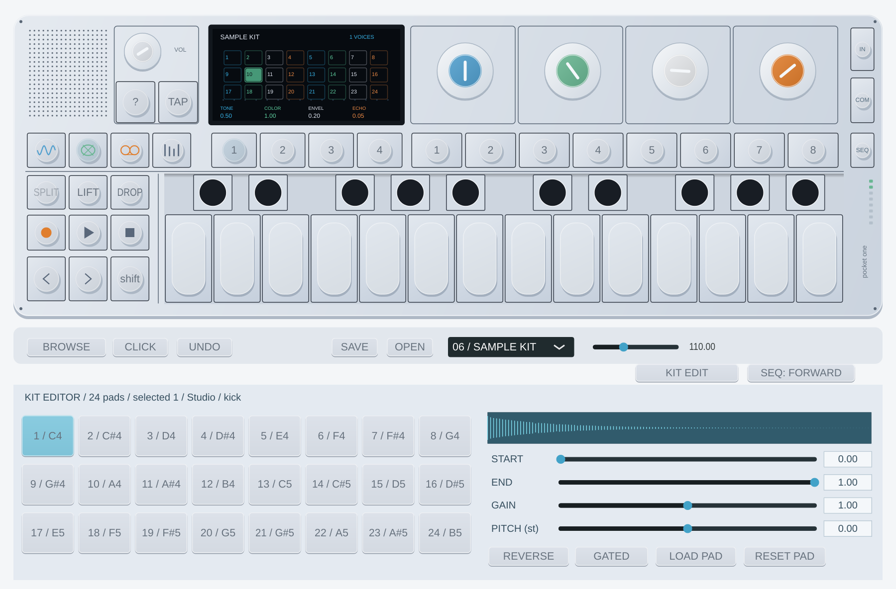

# Kits de 24 pads — Pocket One 0.5.0

Carga un kit desde **DRUM → BROWSE** y pulsa **KIT EDIT**, en la fila inferior junto al selector del secuenciador. El panel sustituye temporalmente la biblioteca; pulsa KIT EDIT otra vez o BROWSE para volver a los sonidos.

Los botones numerados 1–24 seleccionan y preescuchan el pad. La cabecera muestra su nombre de archivo o recurso y la forma de onda indica el tramo elegido. La preescucha envía note-off a los 250 ms: en modo one-shot la muestra sigue sonando; en gated entra en release. Los pads de extensión vacíos de un kit antiguo se seleccionan sin disparar el pad al que el teclado haría wrap.

| Control | Función |
| --- | --- |
| START / END | Recorte normalizado 0–1 dentro del archivo. END debe superar START; un intervalo vacío queda en silencio. El mando global LENGTH del kit puede acortar más ese tramo. |
| GAIN | Nivel individual 0–2. El volumen general sigue afectando a todo el instrumento. |
| PITCH | Afinación individual ±24 semitonos, por velocidad de reproducción; cambia también la duración. Se combina con el tono global del kit y la modulación. |
| REVERSE | Lee el tramo seleccionado desde su final hacia el inicio. |
| GATED | Desactivado: one-shot, ignora note-off y la envolvente de amplitud. Activado: sigue el ADSR del sonido y libera al soltar la tecla; termina al acabar la muestra. |
| LOAD PAD | Carga WAV/AIFF en el pad seleccionado, primeros 16 segundos, convertido a mono como los demás samples. Mantiene sus controles; usa RESET PAD si quieres comenzar con valores neutros. |
| RESET PAD | START 0, END 1, GAIN 1, PITCH 0, REVERSE/GATED desactivados. Conserva el audio. |

Los kits de 24 tienen correspondencia cromática **MIDI 60–83 (C4–B5)**. Por encima, la asignación repite cada 24 notas. Por debajo de MIDI 60 se conservan los alias GM de kick/snare/hats y demás hacia los ocho primeros pads. Los kits antiguos de ocho mantienen su repetición cada ocho notas. Los números 1–8 de la fila de presets siguen recuperando sonidos completos; no seleccionan pads.

Los tres kits de fábrica usan las **24 muestras propias ya existentes**, sin añadir sonidos del firmware: Studio empieza con Studio/Circuit/Dust; Circuit con Circuit/Dust/Studio; Dust con Dust/Studio/Circuit. Cada grupo ocupa ocho pads. Los proyectos anteriores, guardados con ocho muestras y sin `kitCount`, conservan los ocho y sus sonidos.

Cargar un archivo en un pad 9–24 de un kit antiguo lo amplía a 24; los demás pads nuevos quedan vacíos. El cambio modifica la repetición de notas por encima del octavo pad. Los 24 controles y los recursos del kit activo se guardan con el proyecto/sesión y se restauran sin los archivos originales. Los nombres de fuente también se guardan. Los slots de sonido recuerdan controles por pad, pero dependen del banco de origen: un kit construido con LOAD PAD se conserva con **SAVE/proyecto**, no se convierte automáticamente en un banco importable ni en un favorito.

El motor sigue teniendo **ocho voces simultáneas**; 24 pads describe las fuentes disponibles. No se garantiza reproducción idéntica al DSP del OP-1 ni se interpretan automáticamente sus valores de recorte de 32 bits. Los ajustes del firmware motivan la organización; nuestros parámetros usan unidades explícitas.

Las formas de onda se calculan al cargar, fuera del callback. El audio consulta parámetros cacheados y usa almacenamiento fijo para afinaciones. Cargar recursos y guardar/restaurar el estado puede tomar brevemente el bloqueo del callback: haz esas operaciones con el transporte detenido. No hay latencia de buffering añadida; la latencia del dispositivo/DAW se mide aparte.

## CLEAN SAMPLE (0.6.0)

El botón inferior CLEAN SAMPLE corresponde a **Sampler: Clean Playback**. Bypassea la coloración del filtro global y la saturación seca implícita al reproducir sampler/kit. Los efectos y drive elegidos siguen activos. La primera nota tras preparar el motor usa inmediatamente sus valores neutros; los cambios del botón con audio en marcha se suavizan. Los proyectos antiguos conservan el modo desactivado. No equivale a reproducir el circuito analógico o los efectos originales del OP-1.
