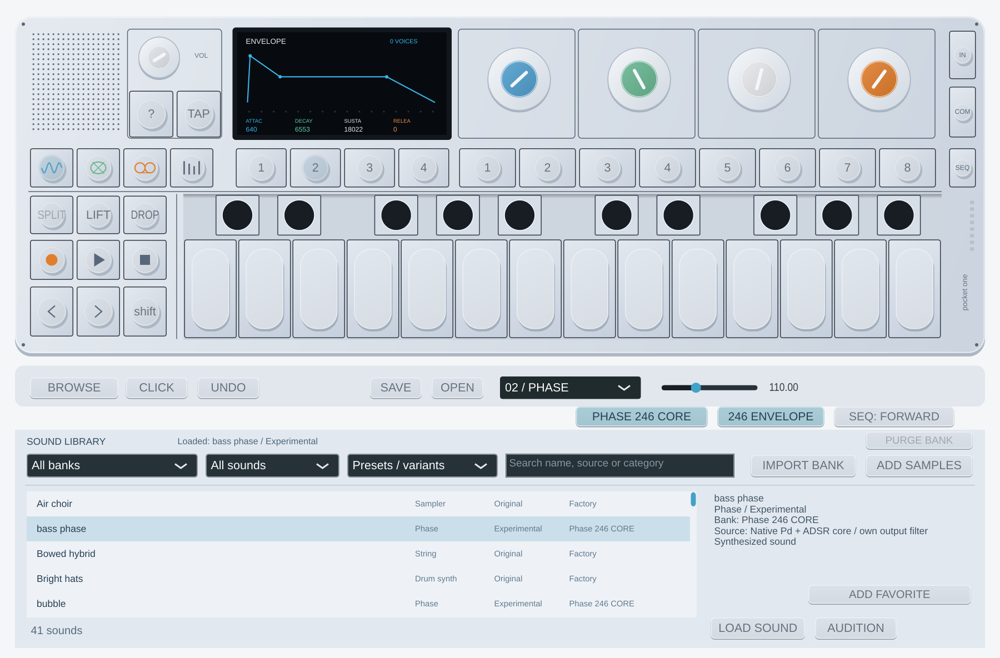

# Phase 246 CORE — modo nativo experimental (0.9.0)

El banco integrado **Phase 246 CORE** ofrece 16 presets adicionales tocables en
tiempo real. Reconstruye el núcleo Pd y, opcionalmente, el núcleo de envolvente
de la revisión 246. Conserva los sonidos anteriores y el banco WAV de estudios.
No necesita descargar muestras ni importar otro ZIP.

## Uso

1. Instala 0.9.0, abre **BROWSE** y selecciona **Phase 246 CORE** / **Synthesizers**.
2. Pulsa **LOAD SOUND** o **AUDITION**. Los presets siguen marcados **Experimental**.
3. Set **1**: azul **SHAPE**, verde **GAIN**, blanco **CONTOUR**, naranja **CYCLES**.
4. Set **2**: **ATTACK / DECAY / SUSTAIN / RELEASE**. Con **246 ENVELOPE** activado
   usa la reconstrucción de envolvente y los primeros cuatro campos ADSR guardados
   en el preset original. Apagarlo recupera la envolvente propia de Pocket One.
5. Sets **3** y **4**: nuestros efectos y LFO. FILTER actúa también sobre Phase
   nativo y muestras CLEAN cuando lo seleccionas con DEPTH mayor que cero.

Los nombres del host son **Phase 246: Envelope Attack / Decay / Sustain / Release**
y **Phase 246: Original Envelope**. Los cinco parámetros nuevos se añaden después
de todos los de 0.8.0; no cambian los IDs ni índices anteriores. Los cuatro
**Screen: Knob 1 Blue / 2 Green / 3 White / 4 Orange** siguen los sets 1–4,
incluso con el editor cerrado. No hay que volver a asignarlos.

En el oscilador: azul/blanco/naranja 0–32767; verde 0–29491, según el inicializador
original. En la envolvente: A/D/R 0–16383, S 0–32767. Estos últimos límites cubren
los índices admitidos por el núcleo observado, no una reproducción de todas las
reglas del controlador físico. Los números son palabras de control, **no ms**.
El release está invertido: números altos acortan la caída; cero puede dejar una
cola muy larga. El plugin informa al host de esa duración. Usa STOP/pánico para
cortar inmediatamente voces y colas; no borra la cinta guardada.

## Proyectos anteriores y presets

Al cargar un preset CORE desde la biblioteca en 0.9.0 se activa la nueva envolvente.
Las sesiones y slots guardados por 0.8.0 mantienen la envolvente propia anterior,
porque la ausencia del nuevo parámetro se interpreta como OFF. Puedes activarlo
manualmente. Las sesiones nuevas, slots y LIFT/DROP guardan los controles editados.
Al cargar un preset anterior se desactivan los modos experimentales.

Los presets con los mismos cuatro controles de oscilador pueden diferenciarse
ahora por su envolvente. No se convierten los cuatro campos ADSR adicionales,
FX, LFO ni octave originales; los nombres siguen siendo los del material fuente,
no una afirmación de que el preset completo suene idéntico.

## Evidencia y límites

- Pd: 1.572.864 muestras comparadas con instrucciones originales en el simulador.
  Las pruebas anteriores también conservan sus resultados al corregir la escritura
  paralela de registros del simulador. Los archivos y paquetes 0.8.0 no se sustituyen.
- ADSR: **256 coeficientes convertidos, 2.621.440 muestras y 20.480 estados completos**,
  con nueve estados/rutas, velocidades/ganancias, dither y callbacks originales
  de nota, release y parada. Coinciden con el modelo GNU documentado con escritura
  diferida de registros. No es una validación acústica del aparato.
- El núcleo funciona a nuestro reloj interno fijo de **88,2 kHz**. Su elección
  se apoya en la constante original del sampler y el análisis comunitario de voces;
  la preparación original completa de pitch y la temporización física siguen abiertas.
- NCO, filtro Butterworth causal, adaptación de frecuencia, mezcla, normalización
  de envolvente, escalado de velocidad y modulación siguen siendo propios. El dither
  se mantiene por voz, no como el flujo global compartido del firmware.
- No hay nueva latencia declarada ni buffer de audio de anticipación. Los filtros
  tienen su retardo de grupo; los cambios de controles y el LFO se suavizan.
  El benchmark no certifica cero dropouts en Ableton/ASIO Windows real.

La corrección GNU se conserva por separado: [método y reproducción](envelope246-research.md).
El banco **Phase 246 Core Studies** anterior conserva su NCO externo a 44,1 kHz y
su envolvente de sampler; no se describe retroactivamente como un render del aparato.

[Estado de los motores](audio-engines.md) · [Rendimiento](realtime-audio.md)

## Banco adicional Digital (0.10.0)

Phase conserva sus sonidos y controles. La nueva versión añade por separado
[Digital 246 CORE](digital246-native.md), con otros 16 presets y las mismas cuatro
asignaciones Screen: Knob. No sustituye este banco ni activa Digital al cargar
sesiones anteriores.
