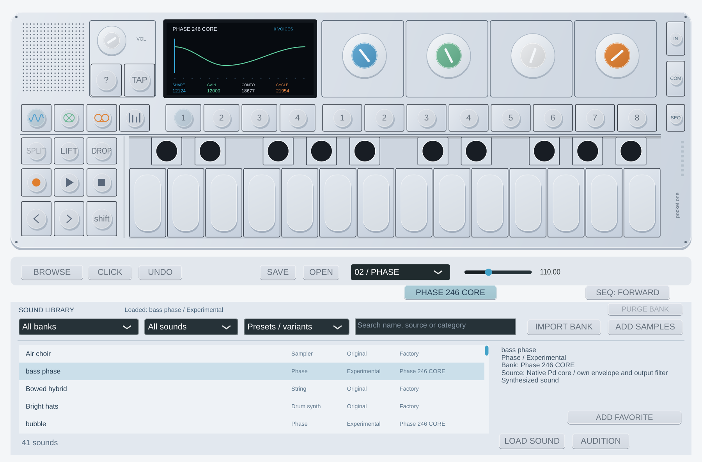

# Phase 246 CORE — modo nativo experimental (0.8.0)

El plugin y el standalone incorporan una reconstrucción independiente del núcleo
Pd de la revisión 246. Ahora se puede tocar y modificar en tiempo real: no es
reproducción de un WAV. El Phase anterior y los bancos existentes siguen disponibles.

## Uso

1. Instala 0.8.0 y abre **BROWSE**.
2. Elige el banco **Phase 246 CORE** y **Synthesizers**. Hay 16 presets con la
   variante **Experimental**. Pulsa **LOAD SOUND** o **PREVIEW**.
3. En el set **1**, azul = **SHAPE**, verde = **GAIN / PRIMARY GAIN**, blanco =
   **CONTOUR**, naranja = **CYCLES**. Son descripciones funcionales de nuestro
   análisis; no se presentan como nombres originales de Teenage Engineering.
4. Los sets **2**, **3** y **4** mantienen nuestra envolvente, delay/drive y LFO.
   Las cuatro asignaciones **Screen: Knob 1 Blue / 2 Green / 3 White / 4 Orange**
   siguen esas páginas sin volver a mapearlas, también con el editor cerrado.
5. El botón **PHASE 246 CORE**, visible en el motor PHASE, permite activar o
   desactivar el núcleo experimental. Al cargar un preset anterior se desactiva.

Los parámetros directos del host se llaman **Phase 246: Experimental Core**,
**Blue Shape**, **Green Primary Gain**, **White Contour** y **Orange Cycles**,
todos con el prefijo `Phase 246:`. Los cuatro controles nuevos usan palabras
enteras: 0–32767, excepto el verde, 0–29491. Los parámetros y sus índices antiguos
se conservan; los cinco nuevos se añaden después de los cuatro proxies MIDI.

Las sesiones, LIFT/DROP y los slots guardan los controles editados y el modo.
Los proyectos anteriores cargan el motor anterior. El banco CORE va integrado:
no necesita descargar/importar muestras y **PURGE BANK** no lo elimina.

## Qué está contrastado

- El núcleo conserva aritmética signed16/Q31, saturación/redondeo, tabla fuente
  senoidal, estados secundarios, reinicios y cruces de ciclo contrastados con
  instrucciones originales en GNU Blackfin. Se comparan **1.572.864 muestras**
  entre las pruebas acumuladas, además de estados finales; no hay diferencias
  en esas condiciones. No es una comparación acústica con el aparato.
- El inicializador original de rangos produce los cuatro límites anteriores.
  La conversión original del sampler usa una constante **88.200 Hz** y coincide
  con siete cálculos independientes entre 55 y 1760 Hz.
- El modo nativo funciona a **88,2 kHz internos fijos** y adapta a la frecuencia
  del host. La afinación se comprueba a 8/22,05/44,1/48/88,2/96/192 kHz.
- Los 16 nombres y juegos de cuatro palabras proceden de los campos almacenados
  en el firmware facilitado por el usuario. Hay 13 juegos distintos: tres pares
  comparten estos campos, aunque sus ajustes originales completos difieren.

## Límites de fidelidad

El NCO/afinación MIDI, suavizado de controles de 12 ms, adaptación de frecuencia,
filtro causal Butterworth de cuatro polos y mezcla son nuestros. Se conserva
la envolvente, modulación, efectos y polifonía de ocho voces de Pocket One.
No se ha reconstruido el despacho completo de voces, preparación original de
pitch, orden exacto de modulación ni decimador del aparato. La evidencia del
reloj de voz común de 88,2 kHz se apoya adicionalmente en el análisis comunitario
op1-sdk; ejecutar el setter del sampler no prueba por sí solo toda esa ruta.

Los presets CORE cargan una envolvente propia neutra, sin drive, delay o LFO del
sonido. No aplican el octave ni ADSR/FX/LFO originales del preset. Los efectos
master o la cinta que ya estuvieran activos en tu sesión se conservan. Los presets
con «lfo», «pad» o «bass» en su nombre pueden diferir mucho del preset completo
original. El núcleo probado no basta para afirmar que el instrumento suena idéntico.

El filtro evita parte del contenido fuera de banda, pero no demuestra ausencia
de aliasing. No hay buffer de anticipación ni latencia adicional declarada; el
filtro causal introduce su propio desfase/retardo de grupo y el ataque ADSR añade
su evolución temporal. Las mediciones de VM/Wine no certifican cero dropouts en Live.

El banco WAV anterior **Phase 246 Core Studies** conserva sus archivos y su
planteamiento de NCO externo a 44,1 kHz; sigue siendo un banco sampler adicional.
No se reemplaza ni se describe retroactivamente como un render a 88,2 kHz.

[Pruebas y reproducción](dsp-research.md) · [Audio en tiempo real](realtime-audio.md)
