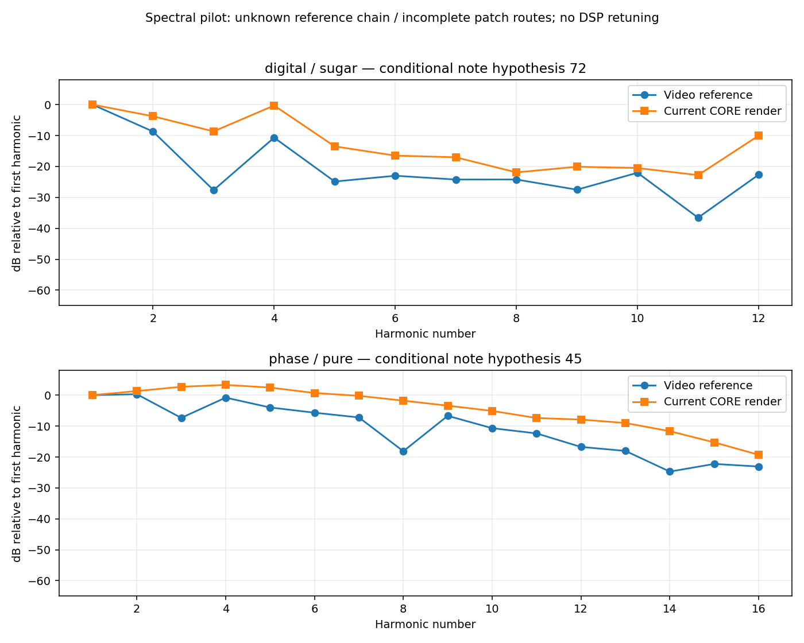

# Primer piloto espectral: Digital y Phase

La comparación con el vídeo ya tiene dos ventanas medidas y un caso descartado
por polifonía. **Las diferencias siguen siendo importantes; no se ha retocado el
DSP para hacer coincidir una grabación cuya cadena y ajustes completos no conocemos.**
Los presets actuales y el instalador 0.13.0 conservan su comportamiento.



[Gráfica vectorial exportable](preset-audio-pilot.svg) · [Mediciones y validación](preset-audio-pilot.json) ·
[Casos reproducibles](../research/blackfin/preset-audio-cases.json) · [Índice del vídeo](preset-video-index.md)

## Qué se midió

Los recortes de audio se alinean con los offsets por paquetes H264 ya documentados.
Se compara el motor `Engine`, su núcleo reconstruido, los primeros cuatro ADSR y
el adaptador/filtro de salida propio. Se omiten **todos los FX/LFO**, aunque exista
una versión opcional en el plugin, y la cadena master/EQ/cinta de `PluginProcessor`.
No es un render de la cadena completa VST3.

El render usa controles de los presets rev246, velocidad MIDI 100, una nota de
dos segundos y duración total de 2,5 s, a 44,1 kHz. La ventana sintética empieza
a 0,4 s. Las notas se **infieren del audio**: Do5/MIDI 72 para Sugar y La2/MIDI 45
para Pure. No se han recuperado eventos MIDI, velocidad ni tiempos de pulsación
del vídeo. Una misma etiqueta no demuestra parámetros idénticos entre revisiones.

| Caso | Ventana global del vídeo | Hipótesis de frecuencia | Resultado |
| --- | --- | --- | --- |
| Digital / sugar | 19:01.350–19:01.850 | Do5, unos 523,7 Hz | Cuarto armónico del render +10,39 dB; tercero +18,99 dB respecto a la referencia, normalizando ambos al primer armónico. |
| Phase / pure | 38:30.100–38:30.900 | La2, unos 110,0 Hz | Tercer armónico +10,05 dB y octavo +16,35 dB en el render. Element está activo en el registro original y se omite en este piloto. |
| Digital / sugar, descarte | 18:54.400–18:54.800 | La autocorrelación sugería un periodo grave | Rechazado: varios tonos y casi ausencia de la fundamental hipotética. No se calcula una diferencia de timbre válida para esta ventana. |

La frecuencia se busca alrededor de la nota propuesta; su coincidencia no valida
la preparación original de pitch, el teclado/octave ni la temporización física.
Las cifras interpoladas dependen de ventana, ataque y ruido; no indican esa
precisión de afinación de toda la máquina. Las magnitudes son bandas de potencia
con Hann y se normalizan al primer armónico, sin ajustar una ecualización.

El control de elegibilidad exige como máximo 15 % de energía fuera de la rejilla
armónica en la banda analizada y fundamental a no menos de 12 dB del pico mayor.
Es una heurística: pasarla no prueba una sola voz. Los dos canales del material
son casi idénticos en estas ventanas; no se atribuye la diferencia a su promedio.

## Qué queda abierto

Sugar es el único de los 32 registros Phase/Digital sin FX ni LFO activos. Aun así,
faltan confirmar parámetros numéricos de la grabación, campos ADSR auxiliares,
modo de ejecución, preparación de nota y cadena completa de salida/grabación.
En Pure se añade Element. No se identifica una causa única para los armónicos
más atenuados, ni se deduce de ellos un filtro original específico.

Los tiempos de attack/decay/release no se calibran con estos recortes: falta
anotar cuándo se pulsa/suelta cada nota y separar colas, otras voces y modulación.
El siguiente paso verificable es revisar la conversión de controles y la salida
original, ampliar las rutas de modulación/FX necesarias y repetir los casos
con notas y condiciones mejor acotadas.

## Dependencias de los 32 registros

La [tabla numérica de dependencias](../research/blackfin/preset-audio-readiness.json)
cruza los nombres con el inventario y las observaciones de pantalla. Punch y Value
tienen componentes contrastados, pero no completan automáticamente un patch.
Los cinco casos sin otra familia FX/LFO activa son Sugar, didg, low end, bass phase
y roar bass; el renderizador de este piloto sigue omitiendo todos sus FX/LFO.

| Motor | Preset | FX activo en rev246 | LFO activo en rev246 |
| --- | --- | --- | --- |
| digital | auto rptr | nitro | element |
| digital | booooh | cwo | OFF |
| digital | daylight | delay | OFF |
| digital | didg | punch | value |
| digital | forgotten | cwo | OFF |
| digital | glenn | delay | value |
| digital | low end | OFF | value |
| digital | lullaby time | delay | element |
| digital | organbratto | spring | tremolo |
| digital | princess | spring | tremolo |
| digital | queff bass | nitro | random |
| digital | recognizer | delay | element |
| digital | sugar | OFF | OFF |
| digital | theremono | spring | tremolo |
| digital | tomorrow | nitro | tremolo |
| digital | violinist | spring | tremolo |
| phase | bass phase | punch | value |
| phase | bubble | spring | tremolo |
| phase | classic lfo | spring | value |
| phase | hold me | cwo | value |
| phase | jangle | grid | tremolo |
| phase | kitt | cwo | OFF |
| phase | lil critter | nitro | tremolo |
| phase | pass band | cwo | tremolo |
| phase | pure | OFF | element |
| phase | reflection | cwo | value |
| phase | roar bass | punch | value |
| phase | rownd bass | OFF | bend |
| phase | schain bass | nitro | element |
| phase | spring pad | spring | value |
| phase | valentines | cwo | OFF |
| phase | werkin it | cwo | OFF |

## Reproducir

Se necesitan un compilador C++17, CMake, Python con NumPy/SciPy/Matplotlib y
FFmpeg, más los dos segmentos originales usados (08 y 16). Ningún MP4, audio ni
fotograma del vídeo se incluye en el repositorio. Las gráficas contienen solo
magnitudes calculadas. El WAV sintético y los cachés se guardan fuera del checkout.

```bash
cmake -S . -B build-analysis -DPOCKET_BUILD_PLUGIN=OFF -DCMAKE_BUILD_TYPE=Release
cmake --build build-analysis --target preset_study_render
python3 scripts/compare-preset-audio.py --self-test
python3 scripts/compare-preset-audio.py \
  --media-dir /privado/segmentos \
  --renderer "$PWD/build-analysis/preset_study_render" \
  --output /privado/piloto-nuevo
```

Para generar un estudio aislado:

```bash
build-analysis/preset_study_render /privado/sugar-C5.wav \
  44100 digital 12 72 100 88200 110250
```

El renderizador requiere un archivo nuevo y no aplica automáticamente el octave
almacenado: el número MIDI especifica la altura de entrada al motor. Admite los
índices 0–15 de cada banco. Windows nativo usa `preset_study_render.exe`.

## Validación de las herramientas

- 13 suites CTest de núcleo superadas en Linux.
- 18 renders: tres tasas (44,1/48/96 kHz), ambos motores e índices 0/8/15; WAV float decodificado, audio finito y rechazo de sobrescritura.
- Nueve invocaciones inválidas rechazadas sin crear archivos.
- Pruebas analíticas de frecuencia, proporción armónica conocida, invariancia de ganancia, rechazo de acordes y silencio.
- Mediciones reproducidas sin cambios numéricos; hashes de fuentes, casos y medios registrados.
- Renderizador Windows compilado y probado bajo Wine: Sugar produjo 110.250 muestras idénticas al render Linux del caso.

Estas comprobaciones validan las herramientas y sus casos; no certifican el
sonido completo del aparato, un proyecto Ableton ni latencia/ASIO nativos.
