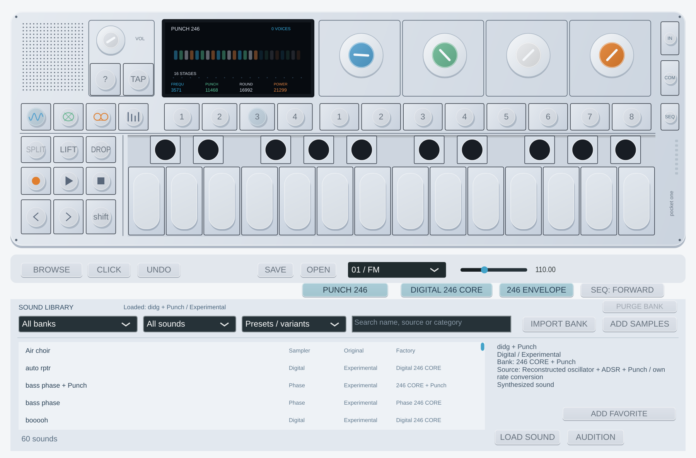

# Punch 246 — Pocket One 0.11.0

**PUNCH 246** activa una reconstrucción independiente del efecto mono de rev246.
El set 3 sigue sus cuatro controles y reutiliza las asignaciones MIDI existentes.
Al apagarlo, ese set vuelve a Echo/Drive. Puede aplicarse a cualquiera de los
motores actuales, antes del delay de sonido; no es aún el master FX original.

| Color | Nombre del manual | Función/rango raw |
| --- | --- | --- |
| Azul | Frequency | Tabla de coeficientes original: 1344…12480 |
| Verde | Punch | Límite de feedback: 0…32767 |
| Blanco | Rounds | 1536…25088; `floor(raw/1024)` etapas, 1…24 |
| Naranja | Power | Ganancia/mix de entrada y salida: 0…32767 |

Los números raw no equivalen a Hz ni a los valores 0–99 del visor original.
Los nombres MIDI son **Punch 246: Blue Frequency / Green Punch Feedback Limit /
White Rounds / Stages / Orange Power / Mix**. Los IDs e índices previos se
conservan; los cinco parámetros nuevos se añaden al final.

**BROWSE → 246 CORE + Punch** ofrece tres variantes adicionales: `didg + Punch`,
`bass phase + Punch` y `roar bass + Punch`. Usan los controles FX almacenados junto
a los núcleos Digital/Phase y ADSR. Los 32 presets CORE anteriores siguen sin
Punch; los proyectos/slots viejos cargan con el efecto apagado. Sus parámetros
nuevos viajan con sesiones, slots y LIFT/DROP.



El núcleo coincide con **131.072 muestras, 2.048 estados completos y 2.048 valores
de display** de las instrucciones originales aisladas. Se contrastan también
129 conversiones de coeficientes, cuatro rangos y el reset. La integración
por muestra reproduce la llamada de 64 muestras a 44,1 kHz sin acumular un bloque
de entrada. Es una comparación bajo el modelo GNU documentado, no de hardware.

La conversión causal de tasas, filtros, eliminación de DC a 5 Hz, cuantización de
entrada, limitación de salida e inserción suavizada en 12 ms son propias. El reloj
de efecto a 44,1 kHz es una hipótesis explícita de integración apoyada por los
bloques 64/128 de FX/voz; no se ha medido aquí el codec original. A otras tasas,
la interpolación causal introduce su retardo de grupo, además de los filtros.
No se declara un bloque extra de latencia ni se afirma latencia física cero.

Con ciertos controles, el feedback original mantiene oscilación después de
terminar la nota. Se conserva ese comportamiento; **STOP/pánico o CC120 lo corta**.
El VST3 declara cola potencialmente infinita con Punch activo, de forma que el
host no la trunque como una release corta. No significa que toda configuración
mantenga el mismo volumen. Tras reset, la integración permanece en silencio hasta
que llegue audio; así el offset del núcleo no vuelve a iniciar sonido por sí solo.

Los bancos son aproximaciones parciales del patch completo: octave, mezcla y
ruteo originales siguen pendientes. Desde 0.12, [Value FX](value246-native.md) permite
modular sus cuatro colores y añade Helicopter como estudio del manual. La
calibración raw/display y la comparación acústica siguen pendientes. [Matriz completa y presets objetivo](original-op1-coverage.md).

Reproducción desde un LDR propio del perfil rev246:

```bash
python3 scripts/verify-punch246.py \
  --ldr /privado/OP1_vdk.ldr \
  --assembler /herramientas/bfin-as --linker /herramientas/bfin-ld \
  --simulator /herramientas/run-dreg-deferred \
  --testutils /fuentes-gdb/sim/testsuite/bfin \
  --output /privado/punch-nuevo
```

Salida nueva fuera del repo. Las instrucciones originales/ELF permanecen privadas;
solo se incluyen harness propio y resultados numéricos. El fixture de salida
empieza con 129 `int32` de tabla y cuatro triples `int16` de rango (540 bytes).
Siguen 2.048 registros de 340 bytes: 64 `int16` de audio, 208 bytes de estado y
un `uint32` con el word de display. La entrada tiene registros de 348 bytes:
208 de estado, cuatro controles `int16`, 64 muestras `int16` y acción `uint32`
(0 continuar, 1 cargar estado, 2 reset). Todo little endian.

[Huellas y funciones](firmware/punch246-validation.json) ·
[Modelo GNU y límites](envelope246-research.md) · [Rendimiento](realtime-audio.md).
