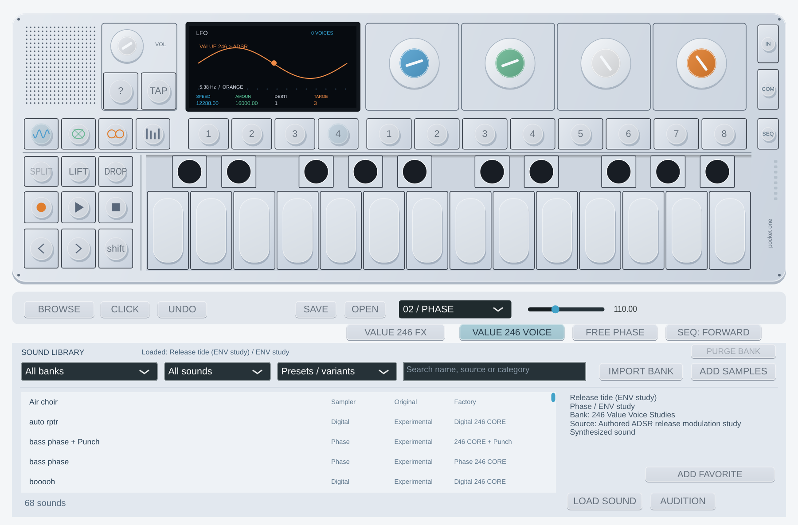

# Value 246 Voice — Pocket One 0.13.0

**BROWSE → 246 Value Voice Studies** añade cuatro variantes con los controles
almacenados de fábrica —glenn, low end, classic lfo y hold me— y **Release tide
(ENV study)**. Se conservan los presets CORE, Punch y Value FX anteriores.
Los efectos originales pendientes de esos patches se identifican en su fuente;
estas variantes se presentan como **Stored core + LFO**.

Con un núcleo **Phase 246** o **Digital 246** activo, abre **set 4 → VALUE 246
VOICE**. Los cuatro mandos MIDI habituales pasan a estos controles:

| Mando | Control |
| --- | --- |
| Azul | Speed: 0…8191 sigue el tempo; 8192…16384 usa velocidad libre. |
| Verde | Amount bipolar: −32767…32767. |
| Blanco | Destination: Instrument o Envelope ADSR. |
| Naranja | Target Colour: azul/verde/blanco/naranja del motor, o Attack/Decay/Sustain/Release. |

Para modular ADSR, activa también **246 ENVELOPE** en set 2. La pantalla indica
el destino; los controles base se guardan sin sobrescribirse con la modulación.
Cada voz lleva su propio estado LFO. **FREE PHASE** conserva la fase al reutilizar
una voz; apagado, la nota la reinicia. En esta integración las voces inactivas
pausan su reloj. La asignación/polifonía de ocho voces sigue siendo propia.

Los botones Voice y FX seleccionan un modo. Si una automatización activa ambos,
Voice tiene prioridad mientras el núcleo Phase/Digital esté activo. Los parámetros
antiguos mantienen IDs, índices y rangos normalizados; los seis nuevos se añaden
al final, con nombres **Value Voice 246: …**. **Screen: Knob 1…4** sigue los controles
con el editor cerrado. Proyectos/slots de 0.12 y anteriores abren Voice apagado;
sesiones, slots editados y LIFT/DROP guardan los nuevos datos.



## Alcance comprobado

La ruta synth de Value coincide en **4.096 llamadas** con las instrucciones
originales aisladas de rev246: 12 bytes de estado, 32 de display, ocho palabras
de destino, retorno y cálculo de tempo. Se contrastan los rangos Digital/Phase
y los primeros cuatro ADSR, cantidad negativa/cero/positiva, clamps, reinicio
y fase libre. Hay 2.048 casos independientes y 2.048 continuados. Las 4.096
llamadas de Value FX anteriores siguen coincidiendo tras compartir la aritmética.

No se portan aquí otras familias, los cuatro controles auxiliares, destinos drum
o cambios de play mode. La adaptación por voz, reparto de notas, suavizado base y
conversión causal de tasa son propios. Se usa un reloj de control **44.100/64 =
88.200/128** por segundo, hipótesis que no demuestra la cadencia/alineación de
toda la máquina física.

Las pruebas cubren siete tasas de reloj, 48 cargas de integración con ocho voces,
15 combinaciones de preset/tasa, pánico, notas con offset y bloques 64/128/256.
Al modular Release, la cola comunicada al host contempla el coeficiente más lento
posible para evitar cortarla prematuramente. No se añade un bloque de audio de
espera; filtros/interpolación siguen teniendo su retardo de grupo.

La comparación con 0.12 produce **1.867.776 muestras idénticas** en las rutas previas:
seis motores, Phase/Digital con ambas envolventes y variantes Punch/Value FX.
No valida cada proyecto ni el sonido completo del OP-1. La [demo aportada](preset-listening-reference.md)
queda pendiente del lote definitivo de segmentos. Los lotes descartados a petición
del usuario no se usan para contrastar el DSP; no se afirma comparación auditiva.

## Reproducción

```bash
python3 scripts/verify-value-voice246.py \
  --ldr /privado/OP1_vdk.ldr \
  --assembler /herramientas/bfin-as --linker /herramientas/bfin-ld \
  --simulator /herramientas/run-dreg-deferred \
  --testutils /fuentes-gdb/sim/testsuite/bfin \
  --output /privado/value-voice-nuevo
```

El directorio debe ser nuevo y quedar fuera del repo. Se incluyen el harness
independiente y resultados numéricos, sin firmware/instrucciones/ELF, DB o vídeo.
La entrada usa registros de 96 bytes como Value FX; el tipo selecciona Digital
(1) o Phase (7). La salida empieza con 128 bytes de rangos de ambos motores y
24 de rangos ADSR; siguen 4.096 registros de 68 bytes: estado, display, destinos,
retorno y tempo.

[Funciones y hashes](firmware/value-voice246-validation.json) ·
[Controles de presets](../research/blackfin/value-voice-controls.json) ·
[Cobertura pendiente](original-op1-coverage.md) · [Rendimiento](realtime-audio.md).
