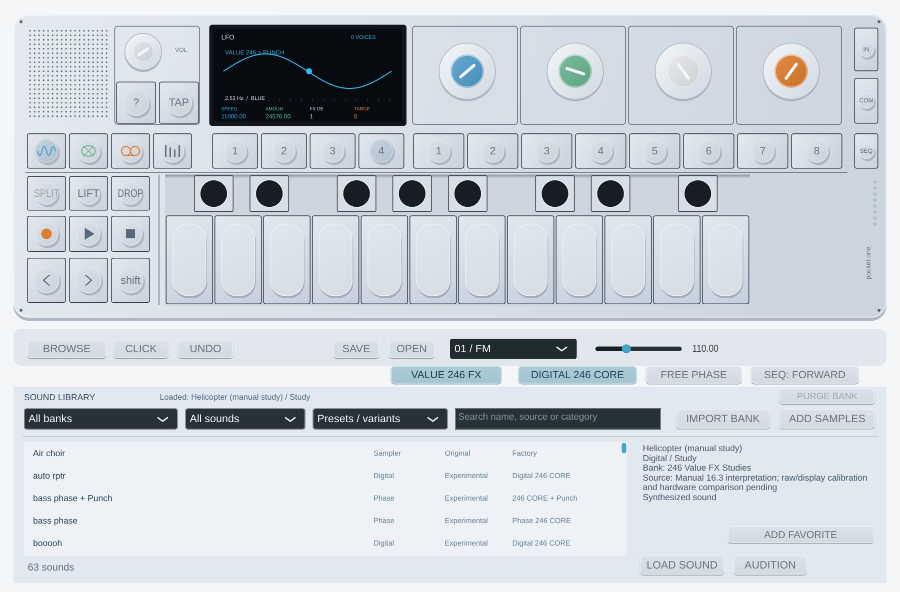

# Value 246 FX — Pocket One 0.12.0

En **set 4 → VALUE 246 FX**, los mismos cuatro mandos MIDI pasan a controlar
velocidad, cantidad, destino y color del efecto. Activa **PUNCH 246** en set 3
para oír la modulación. Al apagar Value, el set 4 vuelve al LFO propio anterior.

| Mando | Control | Comportamiento |
| --- | --- | --- |
| Azul | Speed | Raw 0…8191: ocho divisiones del tempo; 8192…16384: velocidad libre con curva cuadrática. |
| Verde | Amount | −32767…32767, bipolar; cero no modula. |
| Blanco | Destination | Off o Punch FX. Otros destinos originales todavía pendientes. |
| Naranja | Target Colour | Blue Frequency, Green Punch, White Rounds, Orange Power. |

**FREE PHASE** conserva la fase principal entre notas. Apagado, cada nota la
reinicia. Esta opción es independiente de que Speed siga el tempo o tenga una
velocidad libre. El tempo procede del host, o del control local si no hay host.
Value sustituye al LFO propio Pitch/Filter mientras está activo. Los parámetros
base de Punch permanecen guardados sin que la modulación los sobrescriba.

Los parámetros aparecen como **Value 246: Blue Speed (Sync / Free Rate)**,
**Green Amount (Bipolar)**, **White Destination**, **Orange Target Colour** y
**Free Phase (No Note Retrigger)**. Los seis IDs nuevos se añaden después de todos
los anteriores. Las cuatro identidades **Screen: Knob 1…4** siguen funcionando
con el editor cerrado. Sesiones, slots editados y LIFT/DROP conservan Value;
los proyectos/slots de 0.11 y anteriores lo cargan apagado.

**BROWSE → 246 Value FX Studies** añade tres sonidos:

- **Helicopter (manual study)**: interpretación de §16.3, con Digital, ADSR,
  Punch y Value sobre azul. Teclado de pantalla a +4; para MIDI externo, toca
  cuatro octavas más arriba o transpón desde el controlador/host.
- **didg + Value Blue** y **roar bass + Value Blue**: variantes adicionales con
  los campos almacenados de oscilador, ADSR, Punch y Value. Los presets CORE y
  CORE + Punch anteriores conservan sus IDs y comportamiento.

Las posiciones descriptivas del manual y su escala visual 0–99 aún no están
calibradas a raw. Helicopter es un estudio reproducible, no una afirmación de
equivalencia acústica. Los otros dos tampoco incluyen toda la mezcla, modos de
ejecución o campos secundarios del patch original.



## Evidencia y límites

La reconstrucción independiente coincide en **4.096 llamadas** con la ruta FX
aislada de rev246: estado completo de 12 bytes, display completo de 32 bytes,
ocho palabras de destino, retorno y cálculo de tempo. Incluye 2.048 estados
independientes y 2.048 llamadas continuadas, los ocho tipos FX, clamps, cantidad
negativa/cero/positiva, fase free/retrigger y despacho inactivo. Se contrastan
los rangos originales y la multiplicación float32 del tempo.

La prueba ejecuta instrucciones originales privadas con el modelo GNU BF524
documentado. REA confirma por separado los siete tipos LFO y sus controles
predeterminados en el DB; no se usa como prueba de sonido o de emulación Blackfin.
Solo la ruta FX se reconstruye aquí: los destinos de voz y ENV quedan pendientes.

El adaptador usa un reloj propio de control de **44.100 / 64 llamadas por segundo**,
independiente del tamaño del bloque del host y del silencio de entrada. Esa
cadencia es una hipótesis de integración, no una medición del OP-1 físico. No se
afirma que su alineación con notas/mezcla/FX reproduzca el instrumento completo.
La conversión causal y suavizado base de Punch siguen siendo propios; no se
añade un bloque de audio de espera. STOP/CC120 corta también las colas.

Reproducción desde un LDR propio inventariado, en un directorio nuevo fuera del repo:

```bash
python3 scripts/verify-value246.py \
  --ldr /privado/OP1_vdk.ldr \
  --assembler /herramientas/bfin-as --linker /herramientas/bfin-ld \
  --simulator /herramientas/run-dreg-deferred \
  --testutils /fuentes-gdb/sim/testsuite/bfin \
  --output /privado/value-nuevo
```

Fixture little endian: entrada de 96 bytes por llamada: estado 12, display 32,
controles `int16[8]`, destinos `int16[8]`, tempo/kind/FX/acción `uint32[4]` y BPM
`float32`. Acción 0 continúa; 1 carga estado/display; 2 carga y llama reset.
Salida: cabecera de 384 bytes de rangos FX + 24 de rangos Value; registros de 68:
estado 12, display 32, destinos 16, retorno 4, tempo calculado 4. No contiene
instrucciones originales, DB, grabaciones ni ilustraciones del manual.

[Funciones y hashes](firmware/value246-validation.json) ·
[Inventario REA](firmware/rea-lfo-types-summary.json) ·
[Cobertura pendiente](original-op1-coverage.md) · [Rendimiento](realtime-audio.md) ·
[Vídeo de referencia aportado](preset-listening-reference.md).
